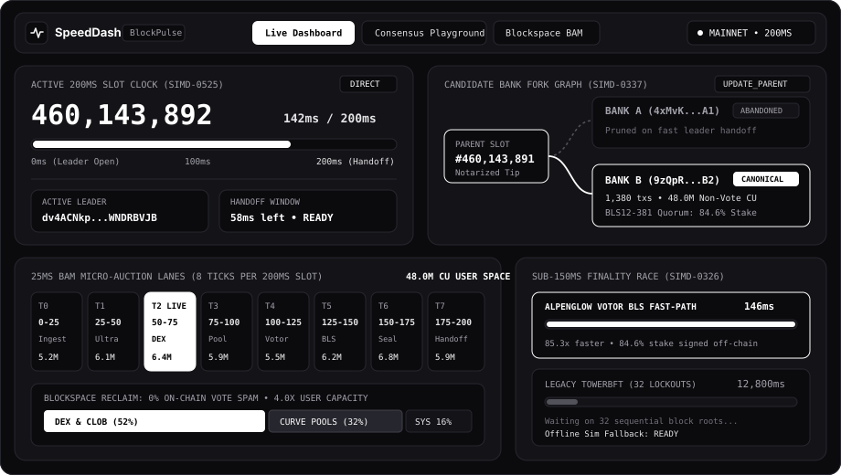

# SpeedDash // BlockPulse



[](#)
[](#)
[](#)
[](./LICENSE)

most block explorers just show a spinning circle and pray bhai, this one shows what validator slots and forks are actually doing every 25ms.

when i wrote the fork graph math at 3am on masala chai only me and bhagwan knew how it worked, now only bhagwan knows, so i added unit tests just in case.

## what is this

* **live 200ms slot clock (`/`)**: watch active Solana slots tick in real time, see who the current validator leader is, and check if a competing fork branch got dropped.
* **interactive fork playground (`/playground`)**: spawn 2 to 4 competing candidate banks, trigger parent switches, race 150ms fast finality against old 12.8s lockouts, and break the network on purpose.
* **blockspace and 25ms auction view (`/blockspace`)**: play with the 48M compute unit bar, drag the TPS slider to see why removing vote spam gives apps 4x more room, and test 8 mini batch ticks per slot.
* **zero api key drama**: talks straight to public Solana RPC from your browser.
* **train wifi friendly**: if your internet dies or public RPC rate limits you, it switches to an offline local simulator automatically (not a bug bhai, free feature).

## run it in 60 sec

```bash
git clone https://github.com/LevCodeLab/blockchain-speed-dashboard.git
cd blockchain-speed-dashboard
npm install
npm run dev
```

open `http://localhost:3000` in your browser.

want to use your own Solana RPC URL instead of the default public node?

```bash
NEXT_PUBLIC_SOLANA_RPC_URL=https://api.devnet.solana.com npm run dev
```

run type checks, unit tests, and static export build:

```bash
npm run typecheck
npm test
npm run build
```

## how to edit and customize

* `app/page.tsx`: main live slot clock, fork graph, finality tracker, and tx signature inspector.
* `app/playground/page.tsx`: interactive fork sandbox, leader handoff timer, finality race, and recorded event player.
* `app/blockspace/page.tsx`: 48M compute unit meter, TPS slider, 25ms batch auction grid, and single pool cap calculator.
* `app/globals.css`: dark obsidian monochrome theme colors (`#0B0B0E` background, `#141418` cards, `#26262E` borders).
* `lib/solana-rpc.ts`: public Solana RPC list, timeout handling, and short memory cache.
* `lib/speed-core/slot-clock.ts`: 200ms slot progress, remaining window, and clock drift math.
* `lib/speed-core/bank-graph.ts`: tracks multiple candidate branches per slot and parent switch pruning.
* `lib/speed-core/finality-engine.ts`: tracks slot observation to ~150ms fast certificate completion.
* `lib/speed-client/client.ts`: browser live stream client plus automatic offline simulation mode.
* `test/speed-core.test.mjs`: `node:test` checks for the core slot, fork, leader, and finality classes.

## license

MIT License. Copyright (c) 2026 LevCodeLab. See [LICENSE](./LICENSE).
